# HerProof — System Architecture

Version 1.0 · Status: Design baseline for the SheCode hackathon MVP · Diagrams are Mermaid (render on GitHub and VS Code).

## 1. Context and goals

HerProof turns opportunity requirements into independently verified candidate competencies.

**Architecture drivers**
1. Trustworthy evidence: every verified competency traces to assessment evidence and a named assessor.
2. Safety: candidate code is hostile until proven otherwise. AI input and output are untrusted.
3. Privacy: POPIA-aligned handling of recordings, transcripts and personal data.
4. Resilience: South African network and power conditions. Demo must survive failures.
5. Speed of delivery: one deployable backend, replaceable providers, thin vertical slices.

**Style:** modular monolith (Clean Architecture layers) + one desktop client + one isolated sandbox runner.
Microservices are explicitly deferred: operational cost exceeds benefit at MVP scale.

## 2. System context (C4 level 1)

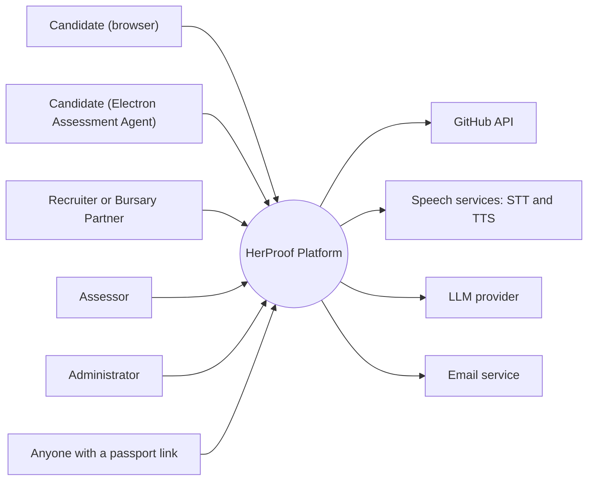

## 3. Containers (C4 level 2)

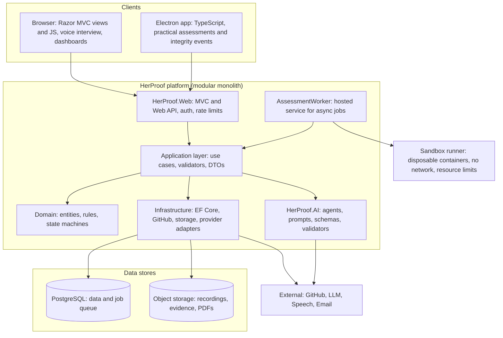

Dependency rule: **Web -> Application -> Domain** and **Infrastructure -> Application (interfaces) -> Domain**.
Domain depends on nothing. AI project depends on Application interfaces only.

## 4. Modules inside the monolith

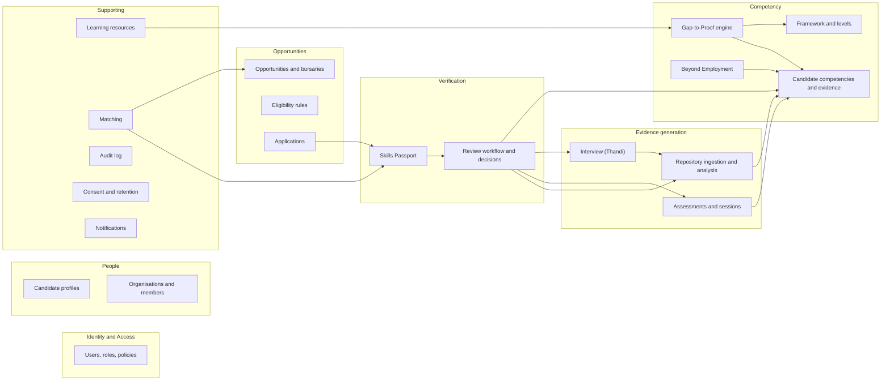

Modules talk through Application interfaces and domain events, never through each other's tables.
Cross-cutting: Audit and Consent are called by every evidence and verification use case.

## 5. End-to-end journey

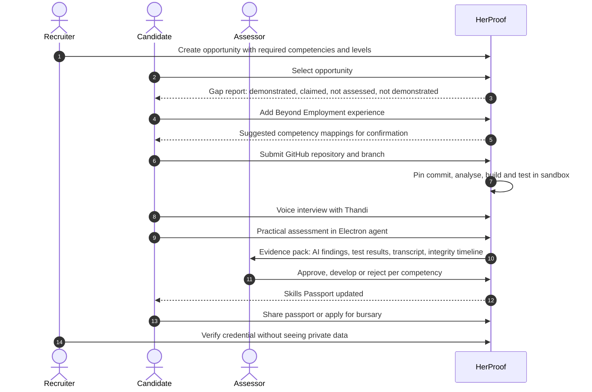

## 6. Repository analysis pipeline

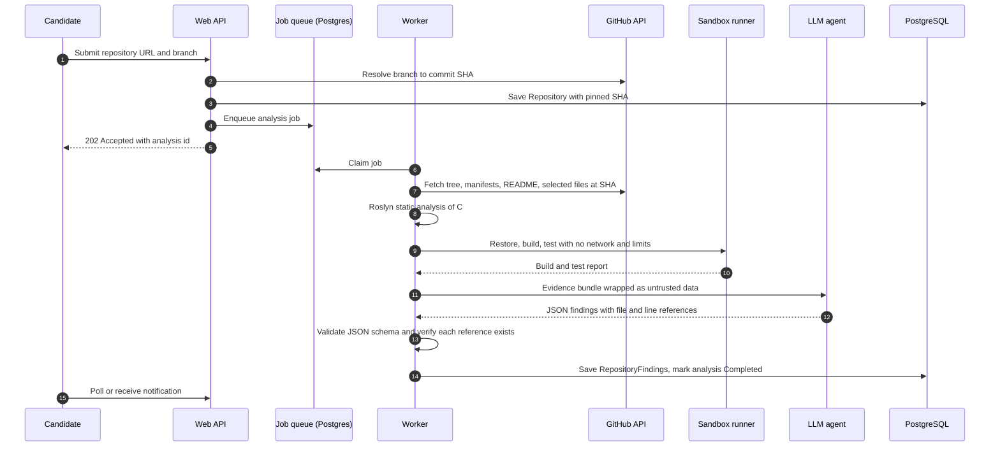

A finding whose file or line reference cannot be verified against the pinned commit is discarded.

## 7. Interview turn loop (Thandi)

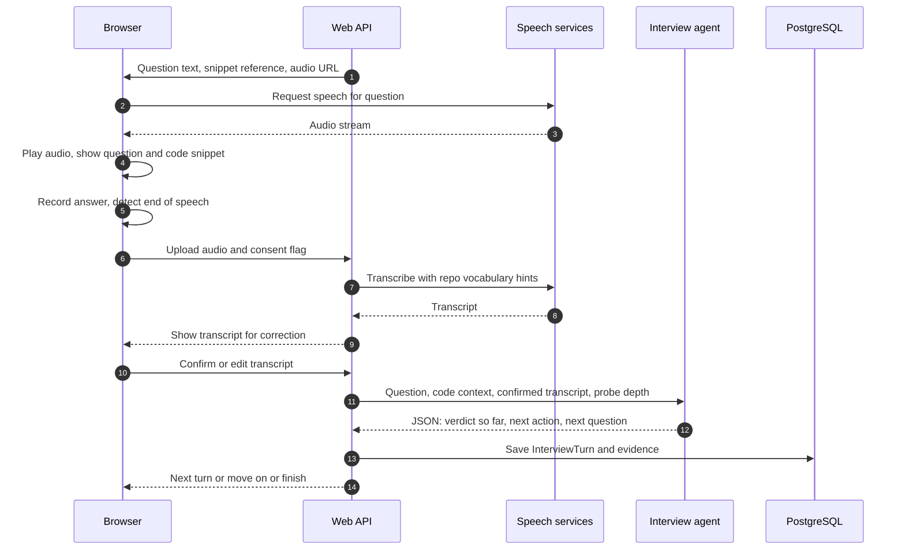

Probe ladder and rubric: docs/06. Maximum three probes per question. Transcript is corrected by the candidate before scoring.

## 8. Electron assessment session

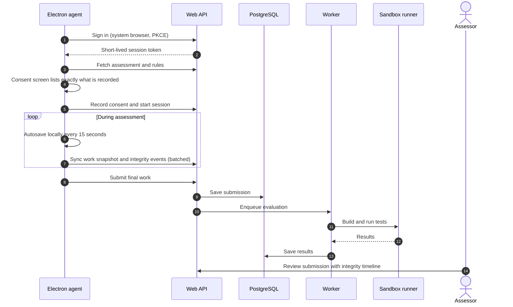

Offline: events and snapshots queue locally and sync when connectivity returns. Gaps are recorded as "connection lost", never as misconduct.

## 9. Competency status state machine

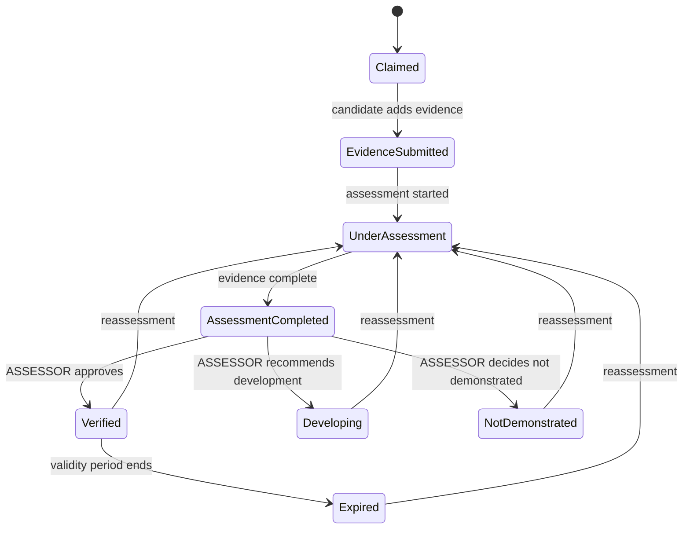

Domain enforcement: `Verified`, `Developing` and `NotDemonstrated` can only be set through `VerificationDecision`
created by a user in role Assessor. Unit-test that every other caller is rejected.

## 10. Assessment session states

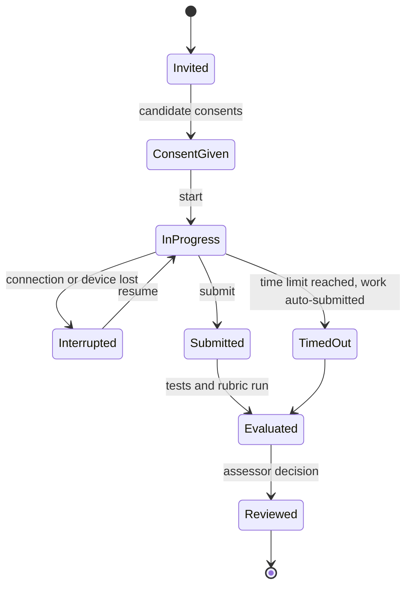

## 11. Deployment view

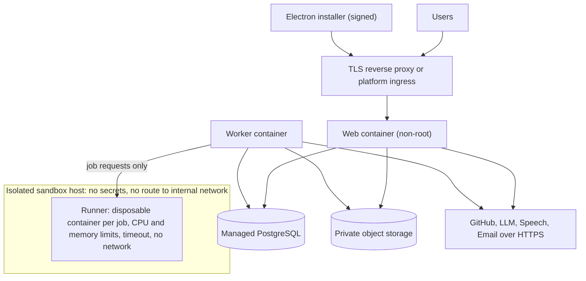

Hackathon option: single host with Docker for web, worker and sandbox, managed Postgres, S3-compatible storage.
Keep the sandbox on a separate host or at minimum a separate Docker network with no egress and rootless runtime.

## 12. Trust boundaries and data flow

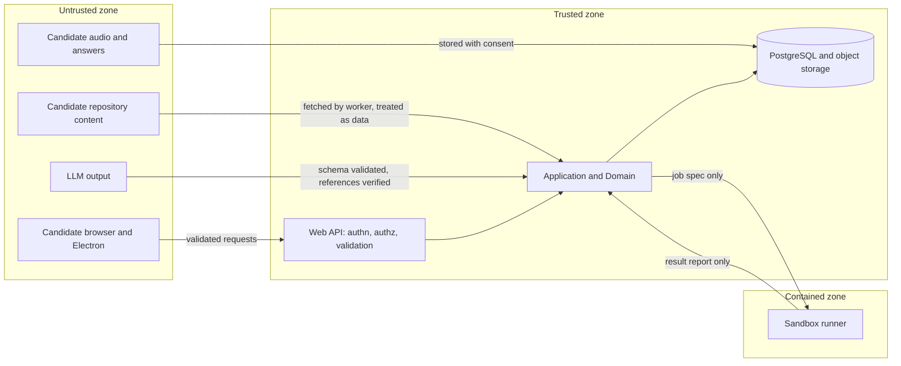

## 13. Technology decisions (ADR summary)

| ID | Decision | Reason | Alternative deferred |
|---|---|---|---|
| ADR-01 | Modular monolith | One deployable, fast to build, clear seams | Microservices |
| ADR-02 | Postgres as queue (SKIP LOCKED) | No extra infrastructure | RabbitMQ, Azure Service Bus |
| ADR-03 | Provider interfaces for AI, speech, storage | Swap vendors, test with fakes | Direct SDK use |
| ADR-04 | Voice in browser, assessment in Electron | Interview needs no install, assessment needs window focus control | Everything in Electron |
| ADR-05 | Server-side STT and TTS | Consistent quality, vocabulary hints, key never in browser | Browser Web Speech API (fallback only) |
| ADR-06 | Pin commit SHA for every analysis | Reproducibility and fairness | Analyse default branch |
| ADR-07 | Append-only VerificationRecords | Auditability | Mutable status column only |
| ADR-08 | Cookie auth for web, token auth for Electron | Right tool per client | One scheme for both |
| ADR-09 | Roslyn for C# static facts plus LLM for judgement | Deterministic evidence anchors the LLM | LLM only |
| ADR-10 | Sandbox on separate network, no egress | Untrusted code containment | Run on web host |

## 14. Non-functional requirements

| Area | Target (MVP) |
|---|---|
| Availability for demo | Works with provider failure via fallbacks |
| Interview latency | Candidate stops talking to Thandi starts speaking: under 3 s typical |
| Repo analysis | Small repo under 3 minutes, async with progress |
| Security | OWASP ASVS L1 minimum, no critical or high findings open at release |
| Accessibility | WCAG 2.2 AA on candidate flows, keyboard operable, captions for audio |
| Privacy | Consent per purpose, retention schedule enforced by job |
| Observability | Structured logs, correlation id per request and job, audit log for decisions |
| Portability | Everything runs from docker compose plus .env |

## 15. Failure modes and fallbacks

| Failure | Behaviour |
|---|---|
| LLM down or invalid JSON | Retry once, then mark analysis "needs retry", show cached demo result in demo mode only |
| Speech STT down | Switch to typed answers, same rubric |
| TTS down | Browser speech synthesis, then on-screen text |
| Microphone denied | Text-only interview offered immediately |
| GitHub rate limit | Use cached tree for pinned SHA, queue retry with backoff |
| Sandbox unavailable | Skip execution evidence, label "not executed", never fabricate test results |
| Electron loses network | Local autosave and event queue, resume and sync, record interruption |
| Time limit reached | Auto-submit latest snapshot |
