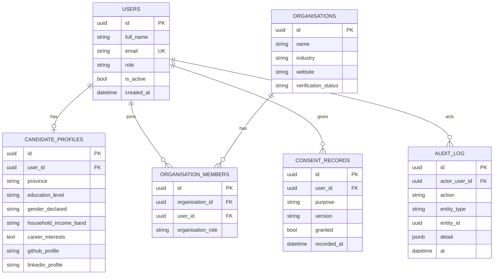
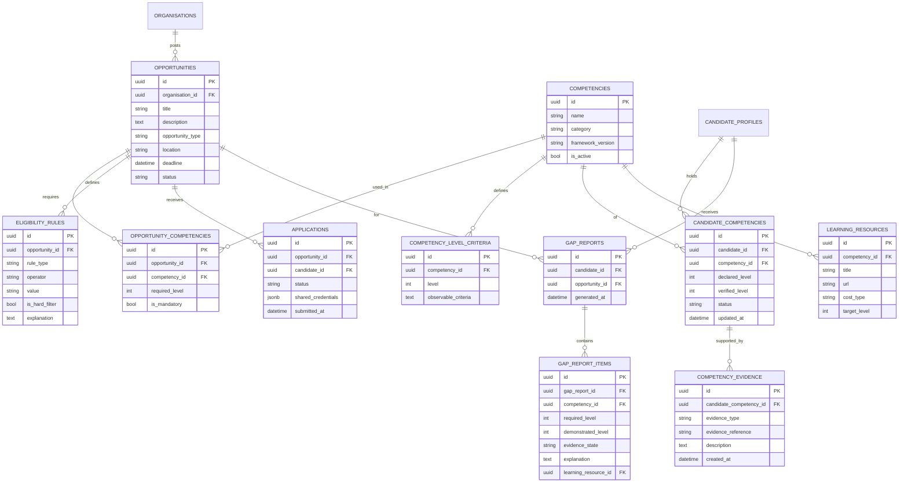
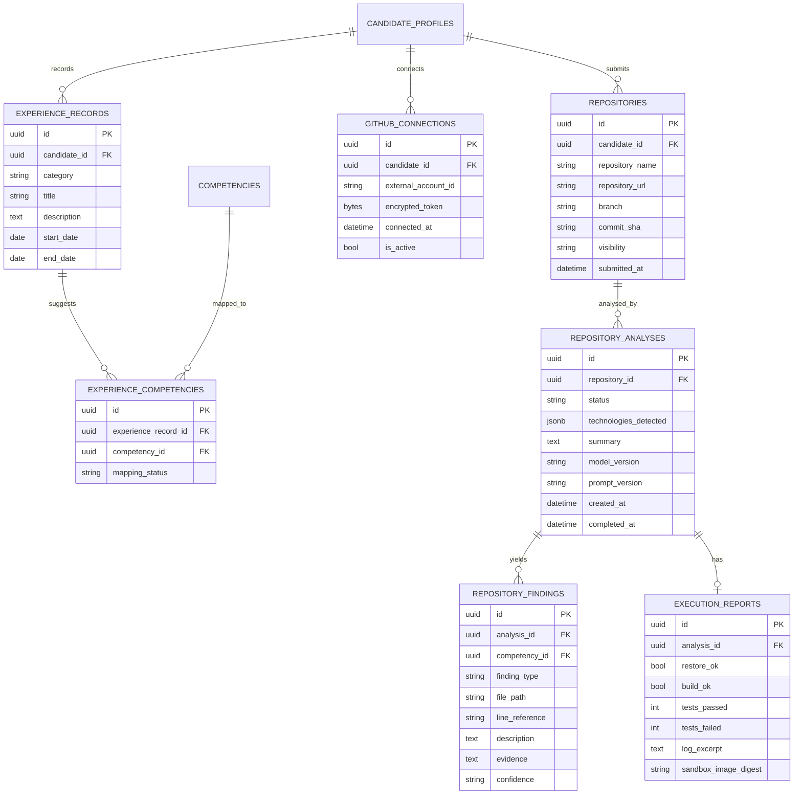
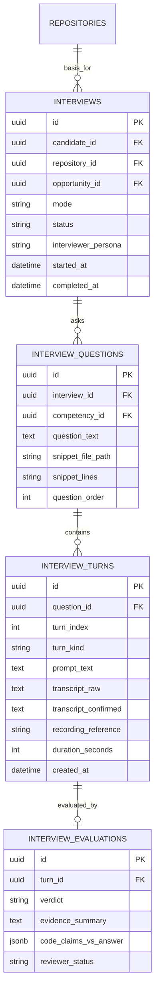
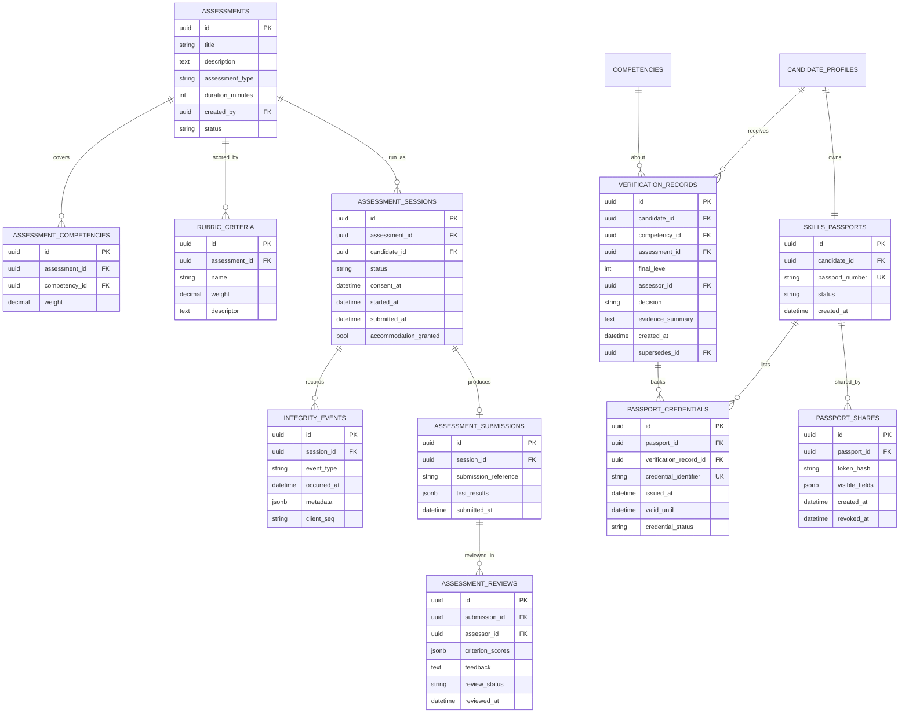

# HerProof — Database Design

PostgreSQL + EF Core. snake_case table and column names (use `UseSnakeCaseNamingConvention`). UUID primary keys. UTC timestamps.

## Rules
1. **Append-only:** `verification_records`, `assessment_reviews`, `consent_records`, `audit_log`, `integrity_events`, `interview_turns`. No UPDATE or DELETE from application code. Enforce with a DB role that lacks those privileges, or triggers.
2. **Candidate edits never rewrite history.** Profile changes do not touch verified records.
3. **Secrets:** GitHub tokens stored encrypted (ASP.NET Data Protection or KMS-wrapped key). Column holds ciphertext only.
4. **Soft delete only for user-facing content.** Personal data deletion requests go through the retention job.
5. **Every FK has an index.** Unique constraints: user email, passport number, credential identifier, (opportunity_id, competency_id).
6. **Enums** stored as strings with check constraints (readable in audits).

## ERD 1 — Identity, profile, organisations

`gender_declared` and `household_income_band` are optional, collected only for bursary eligibility with explicit consent, and never used for AI scoring.

## ERD 2 — Opportunities, bursaries, competencies, gap

`evidence_state` is one of: `Demonstrated`, `ClaimedNotAssessed`, `NotDemonstrated`, `NoEvidence`. `demonstrated_level` is nullable. Null means no assessed evidence, never zero.
Eligibility rule results are computed as Met, NotMet or Unknown. Unknown arises when the candidate has not provided the data.

## ERD 3a — Experience and repositories

## ERD 3b — Interviews

`mode` is `Voice` or `Text`. `verdict` is `Understood`, `Partial` or `NotDemonstrated`. `turn_kind` is `Question`, `Probe` or `Clarify`.

## ERD 4 — Assessments, integrity, verification, passport

`verification_records.decision` is `Verified`, `Developing` or `NotDemonstrated`. A new decision inserts a row with `supersedes_id`, it never edits the old one.
`passport_shares.token_hash` stores a hash of the share token. The raw token appears only in the URL given to the candidate.
`integrity_events.client_seq` is a per-session monotonic counter so the server can detect gaps and duplicates after offline sync.

## Seed data (migrations or startup seeder)
- Competency categories and the five levels (0-4) with observable criteria per competency.
- Software competencies: C#, OOP, SQL, ASP.NET Core, API development, Git, Problem-solving, Testing, Dependency injection, Error handling.
- Non-traditional competencies: Financial management, Scheduling and planning, Project coordination, Business operations, Resource management, Team coordination.
- Learning resources per competency (curated, free where possible).
- Demo data: four candidates, one recruiter, one assessor, one bursary partner, three opportunities, two bursaries.
