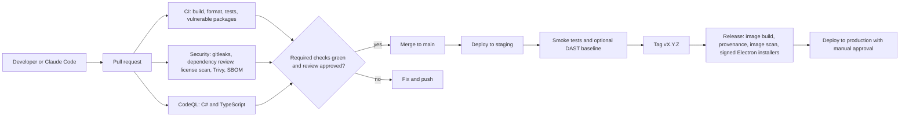

# HerProof — CI/CD and DevSecOps

## 1. Pipeline overview

## 2. What each workflow does

| Workflow | Triggers | Blocks merge | Purpose |
|---|---|---|---|
| ci.yml | PR, push to main | Yes (`CI gate`) | Build with warnings as errors, format check, unit and integration tests with Postgres, vulnerable NuGet gate, migration drift check, Electron lint, typecheck, test, audit, build, Dockerfile lint |
| security.yml | PR, push, weekly | Yes (`Security gate`) | Secret scan, dependency and license review, NuGet and npm license allow-list, Trivy filesystem scan, SBOM |
| codeql.yml | PR, push, weekly | Yes | Static analysis for C# and JavaScript/TypeScript, security-extended queries |
| release.yml | Version tag | n/a | Container image with provenance and SBOM, image vulnerability scan, build attestation, Electron installers for Windows, Linux, macOS, GitHub release |
| dependabot.yml | Weekly | n/a | Update NuGet, npm, GitHub Actions, Docker base images |

## 3. License policy
- Allow-list lives in `licenses/allowed-licenses.json` and is mirrored in `security.yml`.
- Permissive licenses are allowed. Copyleft (GPL, AGPL, LGPL, SSPL) and unknown licenses fail the build until a human reviews them.
- To approve an exception: open a PR that changes the allow-list with a one-line justification. CODEOWNERS must approve.
- Generate the third-party notices file at release time from the SBOM and ship it with the Electron installer.
- Check fonts, icons, datasets and sample code licenses manually. Scanners do not cover them.

## 4. Security gates and severity policy
| Finding | Policy |
|---|---|
| Secret detected | Block. Rotate the secret immediately, even if the commit is removed. |
| Critical or High vulnerability with fix available | Block. |
| High without fix | Document with expiry date in `docs/SECURITY-EXCEPTIONS.md`, review weekly. |
| CodeQL high or critical | Block. |
| Medium | Ticket, fix within sprint. |
| License not on allow-list | Block until reviewed. |

## 5. Environments
| Environment | Deploy | Data | Notes |
|---|---|---|---|
| Local | docker compose | Seeded fake data | Throwaway credentials only |
| CI | Ephemeral Postgres service | Test fixtures | No real provider keys |
| Staging | Auto from main | Synthetic data only | Real providers with low budgets |
| Production | Manual approval on tagged release | Real data | Separate secrets, separate database, backups |

Use GitHub Environments with required reviewers for production. Store secrets at environment level, never in the repo.

## 6. Test pyramid in CI
- Domain unit tests: gap engine, status transitions, rubric scoring, eligibility evaluation, matching. Fast and numerous.
- Application tests: use cases with fakes for AI, speech, GitHub, storage.
- Integration tests: real Postgres, real HTTP pipeline via `WebApplicationFactory`, authorisation matrix for every endpoint.
- AI contract tests: recorded fixtures prove JSON validation, reference verification, and prompt-injection resistance without calling the real model.
- Electron tests: unit tests for event queue and offline sync, Playwright or Spectron-equivalent smoke test for launch and IPC allow-list.
- End-to-end: the ten journeys in the spec on staging, nightly.
- Security tests: from `docs/03` section 12, automated where possible.

## 7. GitHub repository settings to apply on day one
1. Settings > Branches (or Rulesets): protect `main`. Require pull request, 1 approval, CODEOWNERS review, required checks `CI gate`, `Security gate`, `CodeQL`, up-to-date branch, no force pushes, no deletions.
2. Settings > Code security: enable Dependabot alerts and security updates, secret scanning and **push protection**, code scanning (CodeQL is configured by the workflow).
3. Settings > Actions: default workflow permissions read-only, require approval for outside collaborators, restrict actions to GitHub-owned and verified creators plus those you list.
4. Pin third-party actions to commit SHAs once stable (Dependabot can update SHA pins).
5. Require signed commits if the team can manage keys.
6. Enable private vulnerability reporting and add SECURITY.md with a contact.

## 8. Electron release and signing
- Windows: Authenticode certificate. macOS: Developer ID certificate and notarisation. Linux: AppImage or deb with checksums.
- Auto-update only from your own signed release channel, verify signatures before applying updates.
- Never ship dev credentials or `.env` in the package. The app takes the API base URL from build-time config.
- Hackathon: unsigned builds are fine for the demo. Say so, and show the signed pipeline.

## 9. Observability and operations
- Structured logs (Serilog), correlation id per request and per job, no PII or tokens in logs.
- Health endpoints: `/healthz` (liveness), `/readyz` (database, storage). Worker publishes heartbeat.
- Metrics: job queue depth, job duration and failures, LLM latency and spend, STT latency, sandbox timeouts.
- Alerts: failed jobs, sandbox failures, spend over budget, auth anomalies.
- Backups: managed Postgres point-in-time recovery, tested restore.

## 10. Optional DAST baseline (staging)
Run OWASP ZAP baseline against staging nightly after deploy, with an authenticated context for candidate and assessor roles. Treat new High alerts as release blockers.

## 11. Rollback
Images are immutable and tagged. Roll back by redeploying the previous tag. Database migrations are forward-only: write backward-compatible migrations (add, then migrate, then remove) so a rollback does not need a down migration.
