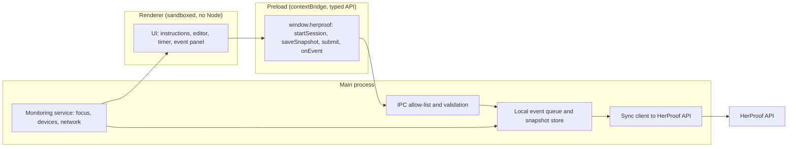

# Electron Assessment Agent Specification

## 1. Purpose
A controlled, transparent desktop environment for timed practical assessments. It proves **live ability under stated conditions**
and produces an integrity timeline for human review. It never decides anything about the candidate.

## 2. Principles
1. Consent first, rules shown before start.
2. The candidate sees exactly what the assessor sees (live event panel).
3. Events are flags for human review. **Never auto-fail.**
4. Minimal collection. No screen capture, no keystroke logging, no clipboard reading, no other-app inspection.
5. Resilient to power and network loss. Never punish a technical failure.
6. Accommodations available (extra time, breaks, alternative arrangements).

## 3. Process model and security (Electron hardening)
- `contextIsolation: true`, `nodeIntegration: false`, `sandbox: true` for every renderer.
- Preload script exposes a tiny typed API through `contextBridge`. No generic `ipcRenderer` exposure.
- IPC channels allow-listed with schema validation on every message (use zod). Reject unknown channels and shapes.
- Strict CSP in the renderer HTML. No remote content. No `eval`.
- Block navigation and new windows: `will-navigate` and `setWindowOpenHandler` deny by default, allow only the HerProof API origin through the main process.
- Disable remote module, `webviewTag: false`, `enableBlinkFeatures` unset.
- TLS only to the configured API origin. Certificate pinning optional.
- Sign in via system browser (OAuth code flow with PKCE). Store refresh token with `safeStorage`.
- Code editor: Monaco bundled locally. No network calls from the editor.
- Auto-update only from signed releases.
- Electron and Chromium kept current. Dependabot plus `npm audit` in CI.



## 4. Session flow
1. Sign in. 2. Load assessment, rules, duration, and accommodation status. 3. Consent screen with the exact event list.
4. Device check (camera and microphone only if the assessment requires them, with preview and indicator).
5. Start. Timer runs server-authoritative (client shows a countdown, server is the source of truth).
6. Autosave to local disk every 15 seconds, sync to server every 30 seconds or on change when online.
7. Submit, or auto-submit at time limit. 8. Confirmation with the event log summary.

## 5. Events (the complete list, shown to the candidate)
| Event | Source |
|---|---|
| assessment_started, paused, resumed, submitted | App |
| focus_lost, focus_regained | BrowserWindow `blur` and `focus` |
| window_closed | BrowserWindow `close` |
| camera_connected, camera_disconnected | Media device events (only if camera required) |
| microphone_connected, microphone_disconnected | Media device events (only if microphone required) |
| network_lost, network_restored | Connectivity checks |
| session_interrupted | Crash or force quit detected on next launch |
| snapshot_saved | Autosave heartbeat |

Event schema:
```json
{
  "session_id": "uuid",
  "assessment_id": "uuid",
  "candidate_id": "uuid",
  "client_seq": 42,
  "event_type": "focus_lost",
  "occurred_at": "2026-11-22T10:15:03.120Z",
  "metadata": { "duration_ms": null }
}
```
The agent can only know that **its own window lost focus**. It cannot see what the candidate switched to, and must not try.

## 6. Offline, resume and load-shedding
- Events and snapshots persist to a local encrypted store with monotonic `client_seq`.
- On reconnect, upload in order. Server dedupes by (`session_id`, `client_seq`) and records gaps.
- On crash or power loss, relaunch detects the interrupted session and offers resume. The interruption is recorded as `session_interrupted`.
- Time lost to verified connectivity or power failure can be restored by the assessor (accommodation), never automatically counted against the candidate.

## 7. How flags are presented to the assessor (never a verdict)
Timeline view: ordered events with durations, such as "Focus lost 00:04 to 00:09 (5 s)". Summary chips: "3 focus changes, 1 network drop (42 s)".
Suggested review prompts, not scores: "Several long focus losses. Consider the task's allowed resources." Assessor decides, and may ask the candidate to explain.
Thresholds only choose what to highlight. They never change a score or status.

## 8. Accessibility and accommodations
Keyboard operable, screen reader labels, adjustable font size and high contrast, extra time, scheduled breaks (pause with reason), alternative arrangements requested before the session. Granted accommodations are recorded on the session and visible to the assessor.

## 9. Assessment workspace
Per assessment, a starter project is provided in a local workspace folder. The candidate edits files in the built-in editor (and may use allowed tools if the rules say so). On submit, the workspace is zipped (size capped, no `node_modules`/`bin`/`obj`), uploaded, and evaluated in the **sandbox runner** by the worker. The agent never runs candidate code on the server and does not need to run it locally unless the assessment allows a local test run inside the app.

## 10. Project structure
```
electron-app/
  src/main/        window, IPC handlers, monitoring, queue, sync, auth
  src/preload/     contextBridge API
  src/renderer/    UI (TypeScript, minimal framework)
  src/shared/      types, zod schemas, event definitions
  tests/           unit tests (queue, sync, schema), smoke test
  package.json  tsconfig.json  .nvmrc  electron-builder.yml
  scripts: dev, build, lint, typecheck, test, dist
```

## 11. Test plan
- Unit: event queue ordering, dedupe, gap detection, resume logic, schema validation rejecting malformed IPC.
- Security: renderer cannot access Node, cannot navigate, cannot open windows, IPC rejects unknown channels.
- Smoke: launch, load session from a mock API, trigger focus loss, confirm event queued and shown.
- Offline: disable network mid-session, verify local persistence and ordered sync.
- Demo: scripted "switch tab" moment verified on Windows and macOS builds used for the presentation.
